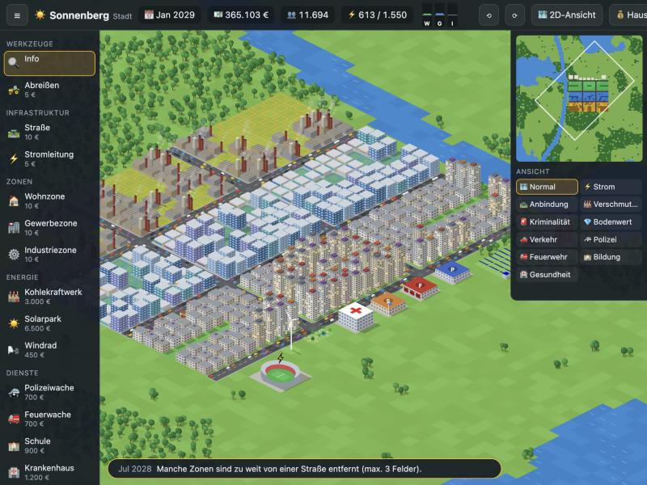
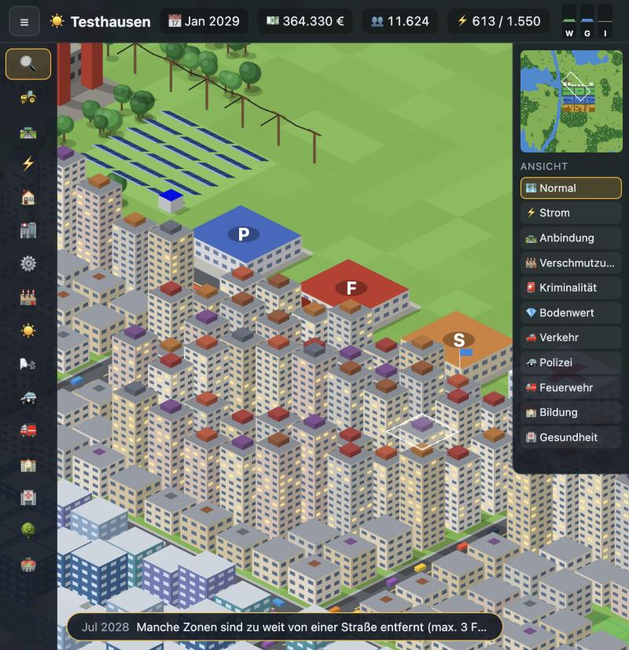

# ☀️ Heliotown

**Eine Städtebau-Simulation, die komplett im Browser läuft – ohne Installation, ohne Internet, ohne Server.**

*Heliotown is a city-building simulation that runs entirely in the browser. Open `index.html` and play – no install, no build step, no network.*



## Spielen

1. Repository herunterladen (**Code → Download ZIP**) oder klonen.
2. **`index.html`** per Doppelklick öffnen. Das Spiel startet im Standardbrowser (Chrome, Edge, Firefox oder Safari).

Zum Mitnehmen auf einen anderen PC einfach den ganzen Ordner kopieren. Es gibt keine Abhängigkeiten und keinen Build-Schritt.

## Funktionen

- **Zufällige Karten** mit Flüssen, Seen und Wäldern in drei Größen (64, 96, 128 Felder) und drei Schwierigkeitsstufen. Eine Vorschau zeigt die Karte vor dem Start.
- **Zonen** für Wohnen, Gewerbe und Industrie. Sie wachsen in drei Ausbaustufen, vom Einfamilienhaus bis zum Wolkenkratzer.
- **Infrastruktur:** Straßen, Brücken über Wasser und Stromleitungen.
- **Energie:** Kohlekraftwerk, Solarpark und Windrad.
- **Öffentliche Gebäude:** Polizei, Feuerwehr, Schule, Krankenhaus, Parks und ein Stadion (ab 3.000 Einwohnern).
- **Simulation:** Stromnetz mit begrenzter Leistung, Nachfrage nach Wohnen/Gewerbe/Industrie, Verschmutzung, Kriminalität, Bodenwert, Verkehr, Brände und Stadthaushalt mit Steuersatz.
- **Berater-Hinweise**, Meilensteine von der Siedlung bis zur Metropole und Statistiken mit Diagrammen.
- **Ansichten** für Strom, Straßenanbindung, Verschmutzung, Kriminalität, Bodenwert, Verkehr und die Reichweite der Dienste.



## Ansicht

Heliotown startet in einer **isometrischen 3D-Ansicht**. Mit **⟲ / ⟳** oder den Tasten **Z / X** drehst du die Stadt in 90°-Schritten. Mit **V** wechselst du zur klassischen 2D-Draufsicht. Ansicht und Drehung werden gespeichert.

## So startest du eine Stadt

1. **Kraftwerk bauen** – Kohle, Solar oder Wind.
2. **Straßen ziehen** – Zonen brauchen eine Straße in höchstens 3 Feldern Abstand. Straßen leiten auch Strom.
3. **Zonen ausweisen** – Wohnen (W), Gewerbe (G) und Industrie (I) per Ziehen aufspannen.
4. **Strom verbinden** – Straßen, Zonen und Gebäude leiten Strom an Nachbarfelder weiter. Lücken über freies Gelände oder Wasser überbrückst du mit Stromleitungen.
5. **Zeit laufen lassen** und die Nachfrage-Balken W/G/I sowie den Haushalt im Blick behalten.

Tipps: Industrie verschmutzt, also Abstand zu Wohngebieten halten. Wasser, Parks und Schulen erhöhen den Bodenwert, und erst hoher Bodenwert lässt Hochhäuser entstehen.

## Steuerung

| Eingabe | Wirkung |
|---|---|
| Linke Maustaste | Bauen; ziehen für Straßen, Leitungen, Zonen und Abriss |
| Rechte/mittlere Maustaste ziehen | Karte verschieben (auch: Info-Werkzeug ziehen) |
| Mausrad, `+` / `−` | Zoomen |
| Pfeiltasten | Karte verschieben |
| `Leertaste` | Pause |
| `1` `2` `3` | Spielgeschwindigkeit |
| `V` | 3D- / 2D-Ansicht |
| `Z` / `X` | Ansicht drehen |
| `Q` `B` `R` `L` | Info, Abriss, Straße, Stromleitung |
| `W` `G` `I` | Wohn-, Gewerbe-, Industriezone |
| `Esc` | Aktion abbrechen |
| `Strg` + `S` | Schnellspeichern |

## Spielstände

- Spielstände liegen im **lokalen Speicher des Browsers** (`localStorage`). Das Spiel speichert automatisch jedes Spieljahr, alle 2 Minuten und beim Schließen. Im Hauptmenü geht es mit „Weiterspielen“ weiter.
- Über **💾 Speichern** legst du beliebig viele eigene Spielstände an (rund 15–20 KB pro Stadt).
- Der Browser-Speicher gehört zum jeweiligen PC und Browser. Um eine Stadt mitzunehmen: **💾 Speichern → „Aktuelles Spiel exportieren“** erzeugt eine `.heliotown.json`-Datei, die du auf dem anderen PC über **„Spielstand-Datei importieren“** lädst.
- Wer Browserdaten löscht, löscht auch die Spielstände. Wichtige Städte daher als Datei exportieren.

## Projektaufbau

```
Heliotown/
├── index.html        Einstiegspunkt
├── css/style.css     Oberfläche
├── js/
│   ├── data.js       Konstanten, Gebäude, Werkzeuge, Hilfsfunktionen
│   ├── state.js      Spielstand, Kartengenerator, Bauaktionen, Speichern/Laden
│   ├── sim.js        Simulation (Strom, Wachstum, Umwelt, Haushalt, Ereignisse)
│   ├── render.js     2D-Draufsicht und Minikarte
│   ├── render3d.js   Isometrische 3D-Ansicht
│   └── ui.js         Spielschleife, Eingabe, Menüs und Dialoge
└── docs/
    └── TECHNIK.md    Technische Dokumentation
```

Reines JavaScript ohne Frameworks oder Bibliotheken. Die Skripte werden als klassische `<script>`-Tags geladen und nicht als ES-Module, damit das Spiel auch direkt von der Festplatte (`file://`) läuft. Alle Grafiken werden zur Laufzeit auf einem Canvas gezeichnet; es gibt keine Bild- oder Tondateien.

Details zu Datenmodell, Simulation, Darstellung und Speicherformat stehen in [docs/TECHNIK.md](docs/TECHNIK.md).

## Früherer Name

Bis November 2026 hieß das Spiel **SunCity**. Der Name wurde geändert, weil „SunCity“ bereits als Marke für ein anderes Computerspiel eingetragen ist. Spielstände aus dieser Zeit übernimmt Heliotown beim ersten Start automatisch, und alte `.suncity.json`-Dateien lassen sich weiterhin importieren.

## Lizenz

Heliotown steht unter der [MIT-Lizenz](LICENSE). Du darfst den Code frei verwenden, verändern und weitergeben, solange der Urheberhinweis erhalten bleibt.

## Hinweis

Heliotown ist ein eigenständiges, unabhängiges Projekt. Code, Grafiken und Texte wurden eigens für dieses Spiel erstellt. Es steht in keiner Verbindung zu anderen Spielen, Spielefirmen oder deren Marken.
